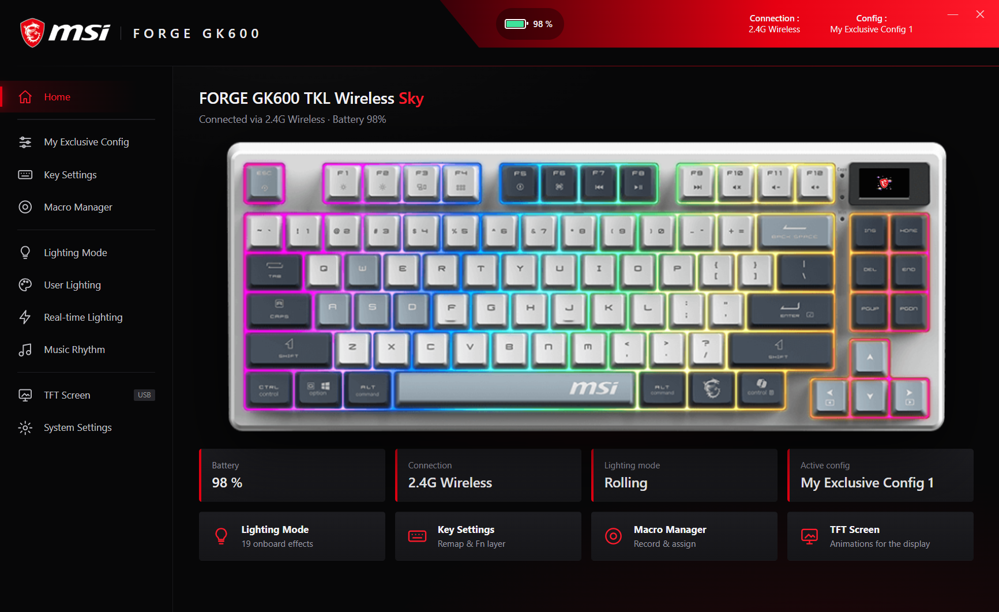

  

<h1 align="center">GK600 Studio</h1>

  A modern control app for the <b>MSI FORGE GK600</b> keyboard family, with a Dragon Center-style design.

  <a href="https://github.com/messaoudi-ghassen/GK600-Studio/releases/latest"><b>⬇ Download the latest version</b></a>

> **Unofficial app.** GK600 Studio is a free community project. It is not made, endorsed or supported by MSI.

## Install

1. Go to **[Releases](https://github.com/messaoudi-ghassen/GK600-Studio/releases/latest)** and download **`GK600-Studio-x.y.z.zip`**.
2. Open the zip and run **`GK600-Studio-Setup-x.y.z.exe`**. No administrator rights are needed.
3. If Windows shows *"Windows protected your PC"*, click **More info → Run anyway**. This appears because the
   installer is new and not yet code-signed.
4. Open **GK600 Studio** from your desktop or the Start menu. Your keyboard is detected automatically.

**Requirements:** Windows 10 or 11 · an MSI FORGE GK600 keyboard. You do not need the official MSI software.

To uninstall: **Settings → Apps → GK600 Studio → Uninstall**.

## Features

| | | |
|---|---|---|
| 🏠 **Home** | Your keyboard, live battery level, connection (2.4G / USB / Bluetooth), active lighting and config | ✅ |
| 💡 **Lighting Mode** | All 19 onboard effects with colour, brightness, speed and direction | ✅ |
| 🎨 **User Lighting** | Paint your own colour on every key | ✅ |
| ⚡ **Real-time Lighting** | Animated effects driven by the app | ✅ |
| 🎵 **Music Rhythm** | Lighting that follows the music on your PC, with colour and background modes | ✅ |
| ⌨️ **Key Settings** | Remap any key: other keys and combinations, mouse buttons, media keys, Windows shortcuts, macros, disable | ✅ |
| 🚀 **Custom actions** | Keys that type a text, open a program, a file or a website | ✅ |
| ⏺️ **Macro Manager** | Record keyboard and mouse macros with timing, 5 play modes | ✅ |
| 🖼️ **TFT Screen** | Animation editor for the 160×96 screen, upload your own GIFs | ✅ |
| 📋 **Configs** | Several setups, switch between them in one click | ✅ |
| ⚙️ **System Settings** | Key response, sleep time, Win / Alt+F4 / Alt+Tab lock, Fn switch, reset, start with Windows | ✅ |

Every change is sent to the keyboard instantly, like the official app.

## Good to know

- **Connections:** the app works over the **2.4G receiver** and the **USB cable**. When the cable is plugged in, the
  keyboard uses the cable. Settings are not available over Bluetooth (same as the official app).
- **Uploading a GIF to the screen** needs **both the 2.4G receiver and the USB cable** connected; the animation is
  sent over the cable and takes about a minute.
- **Keyboard screen pages:** use **Fn + ← / →** to switch pages and **Fn + Enter** to confirm.
- **Close the official MSI app** while using GK600 Studio: both apps talk to the keyboard and can get in each
  other's way. GK600 Studio shows a notice with a one-click "Close MSI app" button when it detects it.
- **Your data stays on your PC** (`%LOCALAPPDATA%\GK600 Studio`). If the official MSI app was installed, your
  current lighting and your saved GIFs are picked up automatically.

## Supported keyboards

| Keyboard | Status |
|---|---|
| MSI FORGE GK600 TKL Wireless (all colours) | ✅ tested |
| MSI FORGE GK600 (wired) | should work, not yet tested |
| MSI FORGE TKL Frieren Edition | should work, not yet tested |

Own another model? Please [open an issue](https://github.com/messaoudi-ghassen/GK600-Studio/issues) and tell us what works.

## FAQ

**Is it safe?** The app only sends the same kind of settings the official MSI app sends. If something ever looks
wrong on the keyboard, switch it off for 10 seconds and on again.

**Something doesn't work / I have an idea.** [Open an issue](https://github.com/messaoudi-ghassen/GK600-Studio/issues) with your keyboard model and what you did.

## License

Free to use. Modifying or redistributing the app is not allowed; share the link to this page instead.
See [LICENSE](LICENSE).

*MSI, the MSI logo and MSI product images are trademarks of Micro-Star International Co., Ltd.*
